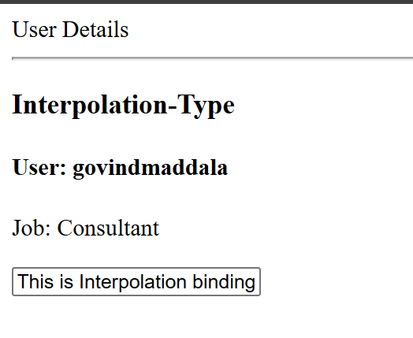
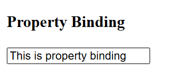
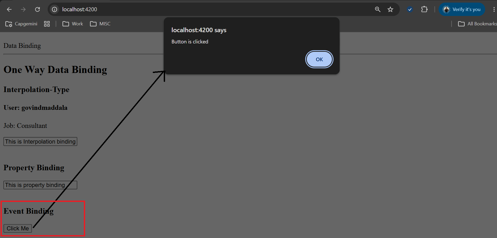
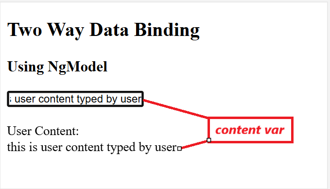

# Angular 19:
## Angular Setup:
- Node Installation
- Typescript Installation. ```npm i -g typescript```
- Angular 19 installation. ```npm i -g @angular/cli@19```
- New Project creation. ```ng new <project_name>```

### Creation and Injection of Component
- #### Creation
    - Creation of component: ```ng g c user```
        ```text
        CREATE src/app/user/user.component.html (20 bytes)
        CREATE src/app/user/user.component.spec.ts (601 bytes)
        CREATE src/app/user/user.component.ts (217 bytes)
        CREATE src/app/user/user.component.css (0 bytes)
        ```
        - it will create user folder in app folder.
- #### Injection
    - Injecting Component
        - Add **UserComponent** in imports in app.component.ts
            ```typescript
            @Component({
                selector: 'app-root',
                imports: [RouterOutlet, UserComponent],
                templateUrl: './app.component.html',
                styleUrl: './app.component.css'
            })
            export class AppComponent {
                title = '0_first_project';
            }
            ```
        - add <app-user></app-user> template in app.component.html
            ```html
            <app-user></app-user>
            <router-outlet />
            ```
### Data Binding:
- #### One-way Data Binding:
    - #### Component(TS file)  to View (Template)
        - ##### Interpolation: {{}}
            - Create variables in ts file and user in html using {{}}:

                ```typescript
                @Component({
                    selector: 'app-data-binding',
                    imports: [],
                    templateUrl: './data-binding.component.html',
                    styleUrl: './data-binding.component.css'
                })
                export class DataBindingComponent {

                    username: string = "govindmaddala";
                    job: string = "Consultant";
                    interPolationValue: string = "This is Interpolation binding";

                }
                ```
            - Use in html with **{{}}** like 

                ```html
                <div>
                    <div>User Details</div>
                    <hr>
                    <h4>User: {{username}}</h4>
                    <p>Job: {{job}}</p>
                    <input type="text" name="propertyBindingValue" value="{{interPolationValue}}">
                </div>
                ```
            - See for value, we are passing value in {{}}
            - Output is like 
                

        - ##### Property Binding: [] 
            - This is only for assigning value to property or attribute but such property or attribute has to be wrapped in [].
            - example 
                - create 
                    ```
                    propertyBindingValue: string = "This is property binding";
                    ```
                - use in html like:
                    ```
                    <input type="text" name="propertyBindingValue" [value]="propertyBindingValue">
                    ```
            
            - Create variables in ts file and use in html using them directly by wrapping that varibale:
                ```typescript
                @Component({
                    selector: 'app-data-binding',
                    imports: [],
                    templateUrl: './data-binding.component.html',
                    styleUrl: './data-binding.component.css'
                })
                export class DataBindingComponent {
                    propertyBindingValue: string = "This is property binding";
                }
                ```
            - Use in html with **[]** like 
                ```html
                <h3>Property Binding</h3>
                <input
                    type="text"
                    name="propertyBindingValue"
                    [value]="propertyBindingValue"
                />
                ```
            - Output is like :
                


    - #### View(Template) to Component (TS file):
        - ##### Event Binding: ()
            - It includes events happened on html and on event we can call any function.
            - In general, in HTML, for event, syntax is like ```<button click="clickMe()">Click Me</button>``` but in angular using event binding, click="clickMe()" changes to (click)="clickMe()"
            - Compoment Setup:
                ```typescript
                @Component({
                    selector: 'app-data-binding',
                    imports: [FormsModule],
                    templateUrl: './data-binding.component.html',
                    styleUrl: './data-binding.component.css'
                })
                export class DataBindingComponent {
                    clickMe(): void {
                        alert("Button is clicked")
                    }
                }
                ```
            - HTML setup is
                ```html
                <h3>Event Binding</h3>
                <button (click)="clickMe()">Click Me</button>
                ```
            - Output is
                

- #### Two-way Data Binding: [()]
    - Here Data will be flowed from Component to View and View to Component.
    - For this, we need to import **FormsModule** into imports object in corresponding component.
    - Then using **[(ngModel)]** we can use it.
    - Code setup is:
        - Component:
            ```typescript
            @Component({
                selector: 'app-data-binding',
                standalone: true,
                imports: [FormsModule],
                templateUrl: './data-binding.component.html',
                styleUrl: './data-binding.component.css'
            })
            export class DataBindingComponent {
                content: string = ""
            }
            ```
        - View:
            ```html
            <h2>Two Way Data Binding</h2>
            <h3>Using NgModel</h3>
            <input type="text" name="user-content" [(ngModel)]="content" />
            <br /><br />
            <div>
                <div>User Content:</div>
                <div>{{ content }}</div>
            </div>
            ```
        - Output:
            


###### 
- To run in production mode:
    - ```ng build --configuration production```
    - ```ng serve --configuration production```


